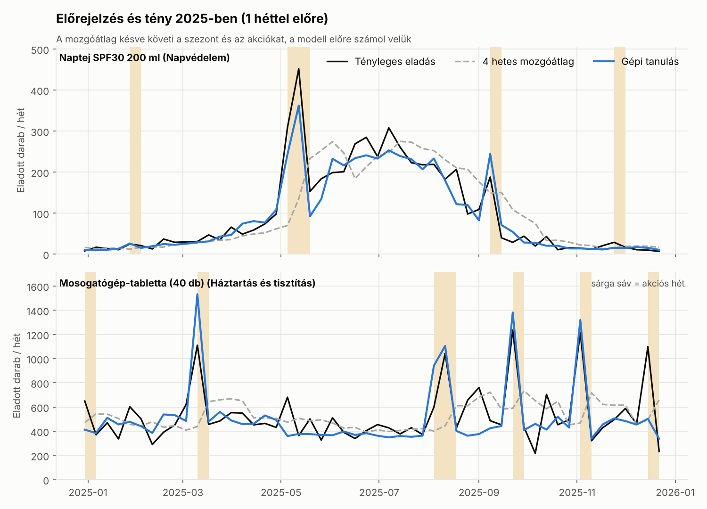
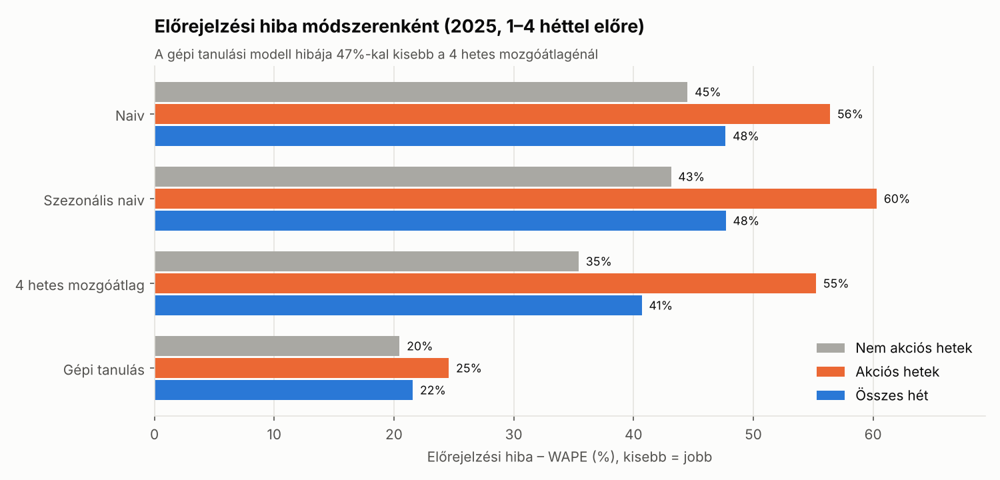
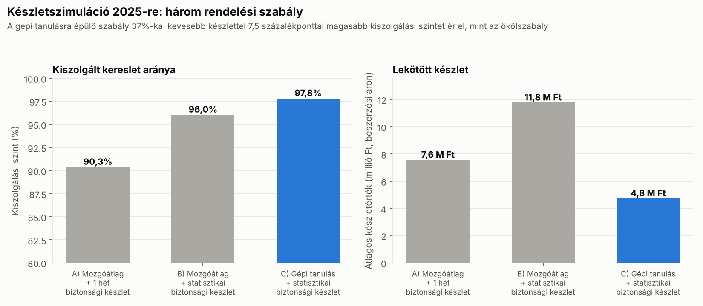
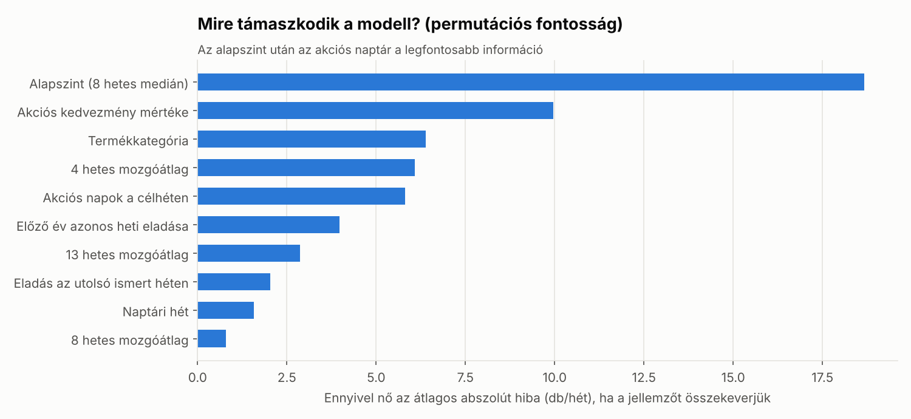

# Keresletelőrejelzés gépi tanulással és készlettervezés (Python)

Egy fiktív drogérialánc, a **Zöldág Drogéria Kft.** központi raktárának heti keresletét jelzi előre gépi tanulással 40 termékre, majd az előrejelzésekből biztonsági készletet, rendelési szintet és rendelési javaslatot számol. A projekt azt mutatja meg, hogy egy ERP-rendszer anyaggazdálkodási (pl. SAP MM) folyamatában mennyit ér egy jobb előrejelzés: kevesebb lekötött készletet és kevesebb elmaradt eladást.

> **English summary:** Weekly demand forecasting and inventory planning for a fictional Hungarian drugstore chain (40 SKUs, 2023–2025). A gradient boosting model (scikit-learn, Poisson loss) uses lagged sales, rolling averages, the planned promotion calendar, public holidays and last-year sales to forecast demand 1–4 weeks ahead. In a 2025 backtest it cuts forecast error (WAPE) from 41% to 22% compared with a 4-week moving average. The forecasts drive a weekly order-up-to inventory simulation with statistical safety stock: compared with a moving-average rule of thumb, the ML-based policy raises the service level from 90.3% to 97.8% while holding 37% less inventory. The project ends with an ABC–XYZ classification and a ready-to-use purchase order proposal.

## Fő eredmények

| Kérdés | Eredmény |
|---|---|
| Mennyivel pontosabb a gépi tanulás? | Előrejelzési hiba (WAPE) 2025-ben: **22%** a 4 hetes mozgóátlag 41%-a helyett – **47%-kal kisebb hiba** |
| Hol a legnagyobb a különbség? | Akciós heteken: a mozgóátlag átlagosan **52%-kal alábecsüli** a keresletet, a modell eltérése kb. 1% |
| Mit jelent ez a raktárban? | Kiszolgálási szint **90,3% → 97,8%**, átlagos készletérték **7,6 → 4,8 millió Ft (−37%)** |
| Mennyi eladás veszett el? | Évi **35,3 millió Ft** helyett **8,2 millió Ft** a ki nem szolgált kereslet értéke |
| Mire támaszkodik a modell? | Az alapszint után az **akciós naptár** (kedvezmény mértéke, akciós napok) a legfontosabb jellemző |









## Javaslatok az elemzés alapján

1. **Az akciós naptár kerüljön be a beszerzési tervezésbe:** a mozgóátlag akciós heteken a kereslet felét sem látja előre, ezért éppen a legnagyobb forgalmú hetekben fogy ki az áru.
2. **Biztonsági készlet a mért hibából, ne ökölszabályból:** az „1 hétnyi készlet” a stabil termékeknél túl sok, a szezonális és akciós termékeknél túl kevés.
3. **Napvédelmi termékek:** a szezon (május–augusztus) előtt 3–4 héttel kell feltölteni a készletet; a mozgóátlag ezt csak a szezon közepén követi le.
4. **Z osztályú termékek** (erősen ingadozó kereslet, pl. naptejek): szorosabb, heti felülvizsgálat és a beszállítóval egyeztetett rugalmas szállítási keret.

## Módszer

### 1. Adatok

| Fájl | Tartalom |
|---|---|
| `products.csv` | 40 termék 6 kategóriában: eladási és beszerzési ár, beszerzési átfutási idő (1–3 hét) |
| `daily_sales.csv` | napi eladott darabszám termékenként, 2023. január 2. – 2025. december 28. (43 680 sor) |
| `promotions.csv` | akciós naptár: 591 akció, 10–33% kedvezménnyel, 2026 januárjáig előre megtervezve |
| `holidays.csv` | magyarországi munkaszüneti napok 2023–2026 |

### 2. Előrejelzés ([`src/forecast.py`](src/forecast.py))

- **Heti aggregálás**, majd minden termékre és hétre egy-egy előrejelzés **1, 2, 3 és 4 héttel előre** (direkt, több horizontú megközelítés).
- **Jellemzők:** az utolsó hetek eladásai és mozgóátlagai, 8 hetes medián mint alapszint, a célhét akciós napjai és kedvezménye, az akció utáni hét, munkaszüneti napok, naptári hét, az előző év azonos heti eladása, termékkategória. Az akciókat a cég előre tervezi, ezért ezek jogosan használhatók.
- **Modell:** `HistGradientBoostingRegressor` Poisson-veszteséggel (darabszám jellegű célváltozó), egyetlen közös modell mind a 40 termékre.
- **Szigorú időbeli szétválasztás:** tanítás a 2025 előtti adatokon, tesztelés a 2025-ös heteken; a modell a tesztidőszakból semmit sem lát.
- **Összevetés három egyszerű módszerrel:** naiv (utolsó hét), szezonális naiv (előző év), 4 hetes mozgóátlag.
- **Mérőszámok:** WAPE (súlyozott abszolút százalékos hiba) és torzítás (alá- vagy fölébecslés), külön akciós és nem akciós hetekre.

| Módszer | WAPE – összes hét | WAPE – akciós hetek | WAPE – nem akciós hetek |
|---|---|---|---|
| Naiv (utolsó hét) | 47,7% | 56,4% | 44,5% |
| Szezonális naiv (előző év) | 47,7% | 60,3% | 43,1% |
| 4 hetes mozgóátlag | 40,7% | 55,2% | 35,4% |
| **Gépi tanulás** | **21,6%** | **24,6%** | **20,5%** |

### 3. Készlettervezés ([`src/inventory.py`](src/inventory.py))

- **ABC–XYZ elemzés:** ABC az árbevételben betöltött súly (80/95%-os határ), XYZ a heti kereslet relatív szórása (0,5 és 1,0 határ) szerint.
- **Biztonsági készlet** = 1,645 × σ (95%-os cél), ahol σ az (átfutási idő + 1) hét alatti összesített előrejelzési hiba szórása egy külön validációs időszakban (2024. II. félév).
- **Szimuláció 2025-re:** heti felülvizsgálat, rendelés a feltöltési szintig (átfutási idő + 1 hét előrejelzett kereslete + biztonsági készlet), a rendelés az átfutási idő után érkezik, a ki nem szolgált kereslet elveszett eladás. Mindhárom szabály azonos kezdőkészlettel indul, az első 4 hetet nem értékeljük.

| Rendelési szabály | Kiszolgálási szint | Elveszett eladás | Átlagos készletérték |
|---|---|---|---|
| A) 4 hetes mozgóátlag + 1 hét biztonsági készlet | 90,3% | 35,3 M Ft | 7,6 M Ft |
| B) 4 hetes mozgóátlag + statisztikai biztonsági készlet | 96,0% | 14,5 M Ft | 11,8 M Ft |
| **C) Gépi tanulás + statisztikai biztonsági készlet** | **97,8%** | **8,2 M Ft** | **4,8 M Ft** |

A B) szabály is javítja a kiszolgálást, de csak sok készlet árán, mert a pontatlan előrejelzés nagy biztonsági készletet igényel. A pontosabb előrejelzés kisebb biztonsági készlettel is jobb kiszolgálást ad.

- **Rendelési javaslat:** a [`results/reorder_plan.csv`](results/reorder_plan.csv) a 2025. december 29-i hétre termékenként megadja a következő 4 hét előrejelzését, a biztonsági készletet, a feltöltési szintet, az aktuális és a beérkező készletet, valamint a javasolt rendelési mennyiséget.

## Futtatás

Python 3.10+ szükséges.

```bash
git clone https://github.com/illesflorian55-prog/demand-forecasting-inventory.git
cd demand-forecasting-inventory
pip install -r requirements.txt

python data/generate_data.py   # adatkészlet generálása -> data/raw/
python src/forecast.py         # modellek tanítása és tesztelése -> results/
python src/inventory.py        # ABC–XYZ, készletszimuláció, rendelési javaslat -> results/
python src/make_charts.py      # diagramok -> images/
```

## Projektstruktúra

```
├── data/
│   ├── generate_data.py   # szintetikus adatkészlet generálása
│   └── raw/               # termékek, napi eladások, akciós naptár, ünnepnapok
├── src/
│   ├── common.py          # adatbetöltés, heti aggregálás, jellemzők
│   ├── forecast.py        # előrejelző modellek és kiértékelés
│   ├── inventory.py       # ABC–XYZ, biztonsági készlet, szimuláció, rendelési javaslat
│   └── make_charts.py     # diagramok a README-hez
├── results/               # eredmények CSV-ben
└── images/                # diagramok
```

## Az adatokról

Az adatkészlet **szintetikus**: rögzített véletlenmaggal generált, így bárki pontosan ugyanazokat az eredményeket kapja. A cég és a számok kitaláltak, de a generátor valószerű keresleti mintázatokat épít be: kategóriánkénti szezonalitást (napvédelem nyáron, ajándékszettek decemberben, tavaszi nagytakarítás), a hét napjainak hatását, termékenként eltérő árrugalmasságú akciókat és az akciók utáni visszaesést, munkaszüneti napokat, éves trendet és véletlen ingadozást. A modell ezeket a mintázatokat nem ismeri, csak az adatokból tanulja meg.

**Korlát:** valós adatokon a hiba várhatóan nagyobb lenne (pl. készlethiány miatt torzult eladási adatok, versenytársak akciói, új termékek), ezért éles bevezetés előtt a modellt a cég saját adatain kellene újra tesztelni.

## Szerző

Illés Flórián – gazdaságinformatikus BSc hallgató, Miskolci Egyetem

## Licenc

MIT licenc, a részletek a [LICENSE](LICENSE) fájlban olvashatók.
